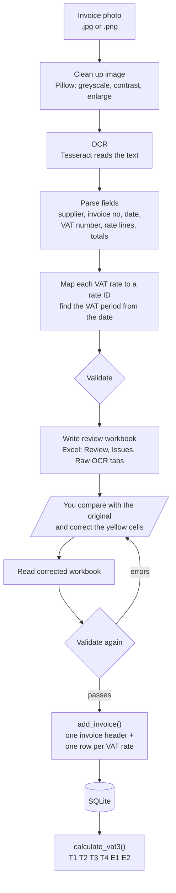
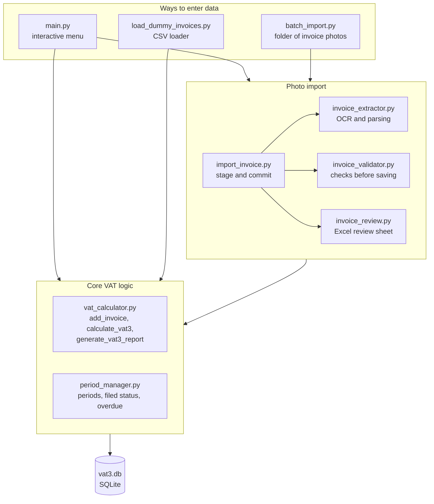
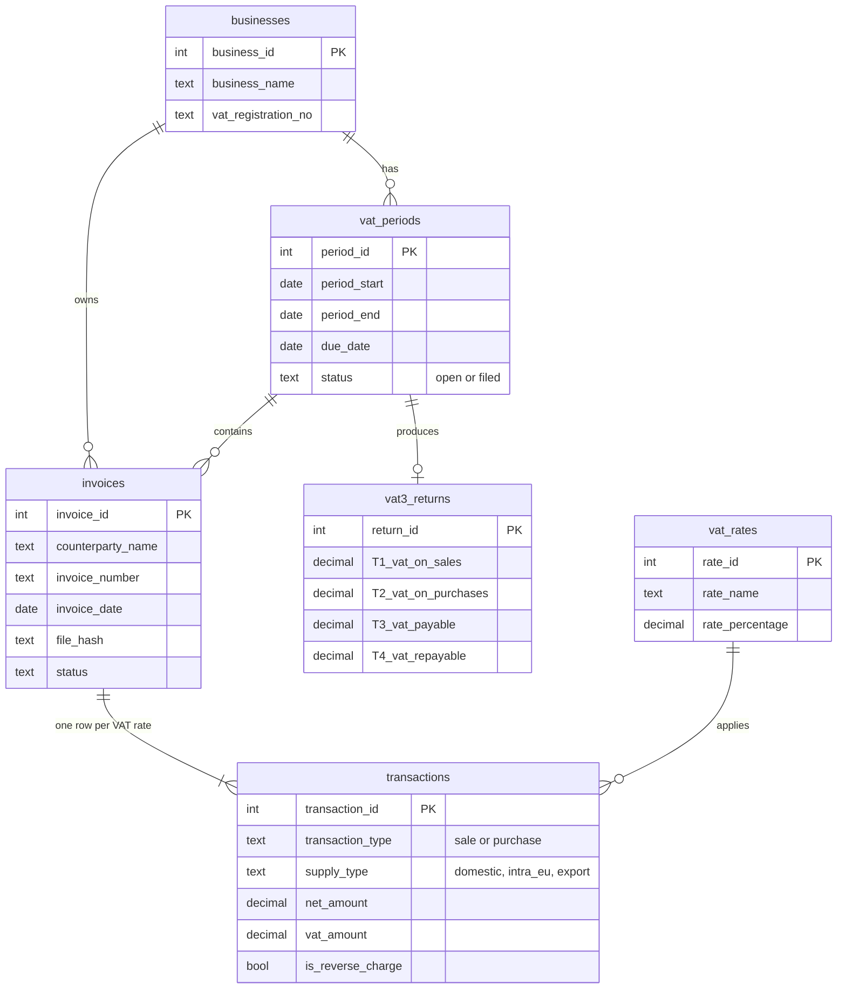
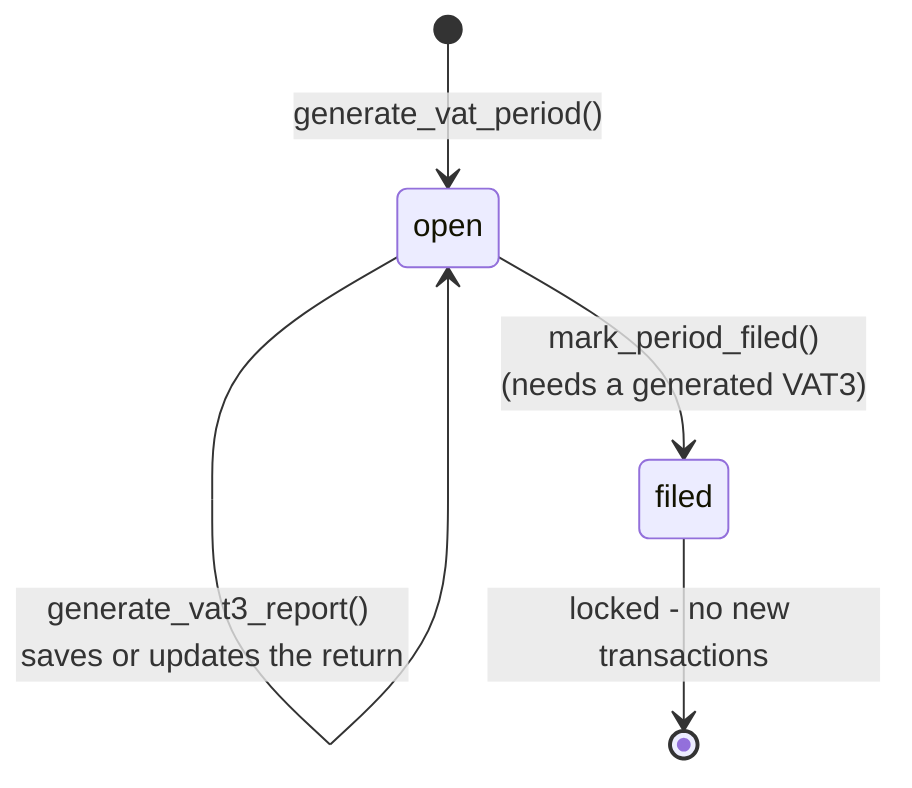

# Irish VAT3 Compliance Tool

A Python and SQLite project that models the Irish VAT cycle end to end: recording sales and purchases, handling multi-rate invoices and EU reverse charge, importing invoice photos through OCR with a human review step, and producing a VAT3 return for a bi-monthly period.

**Status:** working prototype for learning and portfolio use, not a filing tool. It is tested (33 automated tests) and its known limitations are listed below.

> All businesses, suppliers, invoices, VAT numbers and amounts in this repository are **fictional**. Nothing here is tax advice.

---

## What it does

- Records sales and purchases for VAT-registered businesses, one line at a single rate or a whole **invoice with several VAT rates** (one invoice header, one transaction per rate, saved all-or-nothing)
- Applies the Irish VAT rates held in a `vat_rates` table, and checks the chosen rate was in effect on the invoice date
- Handles **reverse charge** on EU B2B purchases: VAT is self-assessed at the Irish rate, shows in both T1 and T2, and the cash payable is the net amount
- Calculates the VAT3 boxes T1, T2, T3, T4, E1 and E2 for a period and saves the return
- Manages bi-monthly VAT periods with the Revenue due date (23rd of the month after the period ends), flags **overdue** open periods, and **locks** a period once it is marked filed
- **Imports invoice photos**: image clean-up, OCR (Tesseract), field extraction, validation, then an **Excel review sheet** where a person checks and corrects the numbers before anything is saved
- Blocks duplicates (same supplier + invoice number, and the same photo file imported twice) and validates dates, periods, VAT arithmetic and document totals
- Imports many invoices at once from a folder, or loads a CSV of invoices

---

## Quick start

**Requirements:** Python 3.8+. The core tool uses only the standard library. Photo import also needs `pytesseract`, `Pillow`, `openpyxl` and the Tesseract OCR program.

```bash
git clone https://github.com/ACCA-LaukikN/Ireland_VAT3_Compliance.git
cd Ireland_VAT3_Compliance
pip install -r requirements.txt        # only needed for photo import
```

Install Tesseract if you want photo import:

| Platform | Command |
|---|---|
| Google Colab / Ubuntu | `apt-get install tesseract-ocr` |
| macOS | `brew install tesseract` |
| Windows | install the UB Mannheim Tesseract build and add it to PATH |

Try it with fictional data:

```bash
python load_dummy_invoices.py     # creates vat3.db, a demo business and loads 15 sample invoices
python main.py                    # interactive menu (Business ID 1)
```

On first run the database is created and upgraded automatically. `vat3.db` is git-ignored.

**Google Colab:** upload the project folder, run `!apt-get -qq install tesseract-ocr` and `!pip -q install pytesseract`, then use `!python load_dummy_invoices.py`. The `input()` menu works best locally; in Colab call `stage_invoice()` and `commit_invoice()` from a cell (see below).

---

## The menu

| Option | Action |
|---|---|
| 1 | Add a transaction (single VAT rate) |
| 2 | Add an invoice with several VAT rates |
| 3 | View the VAT3 calculation for a period |
| 4 | Generate the full VAT3 report (saves or updates the return, then offers to mark the period filed) |
| 5 | Mark a period as filed |
| 6 | Check overdue periods |
| 7 | Create a new VAT period |
| 8 | Import an invoice from a photo |
| 9 | Exit |

---

## Photo import



In code, the two stages are separate so a person is always in the loop:

```python
from db_setup import initialise_database
from import_invoice import stage_invoice, commit_invoice

conn, cursor = initialise_database()

# Stage A: read the photo and write a review workbook (nothing is saved to the database)
# (run load_dummy_invoices.py first so a VAT period covering 1 Nov 2026 exists)
review_path, data, issues = stage_invoice(cursor, "sample_invoices/invoice_multi_rate_photo.png", business_id=1)

# ... open the .xlsx, compare with the original invoice, correct the yellow cells, save ...

# Stage B: re-validate the corrected workbook and save it
commit_invoice(cursor, conn, business_id=1, period_id=None, review_path=review_path)
```

For a folder of photos use `batch_import.stage_folder()` then `commit_folder()`. Purchase and sales invoices should be run separately with the right `trans_type`; for sales the customer ("Bill to") is used as the counterparty.

**What the validator checks:** required fields, date format and period, supplier VAT number format (Irish), VAT = net x rate within a 5 cent tolerance, line totals against the document totals, duplicate supplier + invoice number, and duplicate file. Errors block the save; warnings (for example an OCR slip in the VAT number prefix) are shown for review.

---

## Reverse charge

When a business buys services from an EU supplier, the supplier charges no Irish VAT. The buyer accounts for the VAT itself: it appears in **T1** as if charged, and in **T2** as a deduction (where the buyer is entitled to it), so the net cash effect is nil. The net value is also reported in a statistical box (see limitations).

In this tool a reverse-charge invoice is entered with the Irish rate that applies (for example 23%), the invoice must show no VAT, and the document total is compared with the **net** amount. Example from the sample data: net 1,500 at 23% gives self-assessed VAT of 345.00, added to both T1 and T2.

---

## How it fits together



### Data model



### Period lifecycle



PNG copies of all four diagrams are in `docs/`.

---

## Irish VAT rates in the database

Seeded in `db_setup.py`. Rates were checked against published guidance in November 2026 - **always confirm against Revenue.ie before relying on them**.

| Rate | % | Examples |
|---|---|---|
| Standard | 23% | Most goods and services |
| Reduced | 13.5% | Construction, cleaning, vet fees, coal and heating oil, hotel and short-stay accommodation |
| Second reduced | 9% | Gas and electricity, newspapers, sporting facilities; restaurant and catering food and hairdressing **from 1 July 2026** (13.5% before that date) |
| Livestock / agriculture | 4.8% | Livestock |
| Zero rated | 0% | Most food, children's clothing, oral medicines, printed books |
| Exempt | 0% | Financial services, insurance, education, healthcare |

The tool does not decide which rate a supply attracts; the user (or the invoice) supplies it, and the tool checks the arithmetic and that the rate existed on the date.

---

## VAT3 boxes

| Box | Description | Status |
|---|---|---|
| T1 | VAT on sales, plus reverse-charge VAT self-assessed | Implemented |
| T2 | VAT on purchases (input VAT), including reverse-charge VAT | Implemented |
| T3 | Net VAT payable (T1 - T2 if positive) | Implemented |
| T4 | Net VAT repayable (T2 - T1 if positive) | Implemented |
| E1 / E2 | Value of **goods** supplied to / acquired from other EU states | Implemented, but see limitations |
| ES1 / ES2 | Value of **services** supplied to / acquired from other EU states | Not implemented |
| PA1 | Postponed accounting on imports | Not implemented |

---

## Sample output

From `python load_dummy_invoices.py`, May-June 2026 period (all fictional):

```
==================================================
VAT3 RETURN — Demo Traders Ltd
VAT Reg No: IE1234567T
Period: 2026-05-01 to 2026-06-30  (open)
Due Date: 2026-07-23
==================================================
T1  VAT on Sales:          €1679.00
T2  VAT on Purchases:      €1728.40
T3  Net Payable:           €0.00
T4  Net Repayable:         €49.40
E1  Intra-EU Sales:        €4500.00
E2  Intra-EU Purchases:    €5500.00
==================================================
```

T1 = 414.00 (one domestic sale) + 1,265.00 (reverse charge on three EU services: 345 + 736 + 184). T2 = 463.40 (domestic purchases) + the same 1,265.00.

---

## Tests

```bash
python test_core_vat.py        # 17 tests: transactions, duplicates, multi-rate invoices, filing, reverse charge, schema upgrade
python test_photo_import.py    # 16 tests: parsing, validation, review workbook, OCR end to end, CSV loader
```

The OCR tests are skipped automatically if Tesseract is not installed. Both files use an in-memory database, so your `vat3.db` is never touched.

---

## Project structure

```
.
├── main.py                 # CLI menu
├── db_setup.py             # schema, in-place upgrade, VAT rate seed
├── vat_calculator.py       # add_transaction, add_invoice, calculate_vat3, generate_vat3_report
├── period_manager.py       # create periods, mark filed, overdue check
├── invoice_extractor.py    # image clean-up, OCR, field parsing
├── invoice_validator.py    # checks before anything is saved
├── invoice_review.py       # Excel review workbook (write and read back)
├── import_invoice.py       # stage_invoice / commit_invoice
├── batch_import.py         # whole-folder import
├── load_dummy_invoices.py  # load sample_data/dummy_invoices.csv
├── add_demo_business.py    # create a demo business and period
├── make_sample_invoices.py # generate fictional sample invoice images
├── sample_data/            # dummy_invoices.csv (15 fictional invoices, assumptions noted per row)
├── sample_invoices/        # fictional invoice images used by the tests
├── docs/                   # diagrams (.mmd source and .png)
├── test_core_vat.py
├── test_photo_import.py
├── requirements.txt
└── README.md
```

---

## Design decisions

- **Invoice header plus one row per VAT rate.** Real invoices mix rates, and the VAT3 is built from VAT by rate, so one invoice becomes several transactions linked by `invoice_id`.
- **Validate everything before writing, then save all-or-nothing.** A half-saved invoice would silently corrupt a return.
- **A person reviews OCR output.** OCR misreads characters (for example `IE` as `1E`), so extracted values go to an Excel sheet with live check formulas before they reach the database.
- **Keep the VAT printed on the invoice, within a 5 cent tolerance.** Suppliers round differently; a larger difference is treated as an error.
- **Rules in code, backstops in the database.** Unique indexes and foreign keys catch anything the Python checks miss.

---

## Known limitations and roadmap

- **EU services are reported in E1/E2.** On the real VAT3, services belong in ES1/ES2 and goods in E1/E2. The sample data's EU invoices are services, so the E1/E2 totals above would not match a real return. Next step: a goods/services flag per transaction and the ES1/ES2 boxes.
- **Money is stored as floats.** Moving to `Decimal` or integer cents is planned.
- **OCR is rule-based and was tuned on the sample layouts.** Accuracy on other layouts has not been measured; the review step exists because of this. PDFs are not supported.
- **The accounting basis field is stored but not used** (invoice vs cash basis).
- **Not covered:** partial exemption, non-deductible VAT, flat-rate and RCT rules, postponed accounting, OSS, bad-debt relief, multi-user access.
- This tool prepares figures; it does not file with Revenue.

---

## Author

Laukik Naik
M.Sc. Corporate Finance, University of Galway (2025)
ACCA (in progress) | Xero Certified Advisor
[LinkedIn](https://www.linkedin.com/in/laukiknaik-368319165)
